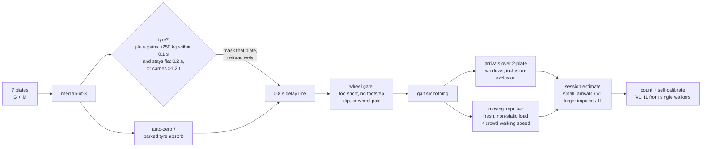

# Prototype : Counting people in Kumbh

**Setting: the gates of the Ram Ghat premises on Ramghat Marg, Ujjain (Simhastha Kumbh).** Ram Ghat on the Shipra river is the main bathing ghat of the Ujjain Kumbh. Ramghat Marg leads to it from Dani Gate and Mahakaleshwar.

The arrangement follows how the ghats were run at Simhastha 2016: **entry and exit kept apart by barricades, so that incoming and outgoing crowds never meet** ([crowd-safety measures](https://simhastha.org.in/simhastha-2016-stampede-prevention-crowd-safety), [controlled entry and exit at Ram Ghat](https://ujjainmahakaltourism.com/ram-ghat-guide)). The marg is split lengthwise into two one-way corridors, **a 7 m entry corridor and a 7 m exit corridor** (no official width for the 2016 routes was published; 7 m is the marg's own width, used for each), each with its own gate. In each gate a strip of 14 load-cell plates spans the corridor's full width. Everyone through the entry gate is walking *into* the premises (←); everyone through the exit gate is walking *out* (→). The boards report:

- **people crossed** the strips;
- how many went **in** (the entry gate) and how many came **out** (the exit gate);
- **how many people are inside the premises right now** (in − out, plus a starting headcount you can set).

One Arduino Mega per gate reads its 28 HX711 channels at 80 Hz; the two boards are joined by a serial cable and share their totals, so either one knows the number inside and can raise the overcrowding alert. Each plate's 4 load cells are wired as two bridges, which lets the board see which way weight moves on a plate: on a one-way gate that is only needed to drop people who step onto the strip and turn back, and it is what makes direction measurable on a two-way strip (the earlier v3 layout, still available as a build option). This repository contains:

- the **firmware**: a counting engine (how many) and a direction tracker (which way), with a gate role setting;
- a **calibration sketch** for all 14 plates × 2 bridges of a gate;
- a **simulator with a local web app**. It runs the real Arduino sketch unmodified, on both gate boards at once, against a physics model of the ghat approach and shows the live "inside the premises" counter. It also benchmarks accuracy.

> **Result in simulation** (separate entry and exit gates, 3 seeds × 10 min per scenario):
> - **Crossings counted:** 96–99.0% accurate when people walk their natural, slightly wandering paths; 93% in a 140/min Kumbh crowd with 60% non-linear walkers; about 86% (over-counting) when everyone jostles or meanders.
> - **In / out:** the direction is the gate's, so the entry and exit counts are as accurate as the crossing count (94–100%) at every crowd level.
> - **Inside count:** within 1–8 people of the truth over 10 minutes at 4–36 people/min; 11–24 people off per 3,600–7,400 crossings in 75–140/min crowds; about 1.5% of the crossings in a bathing rush of 3,000 people.
> - **Crush (450+ people/min in a corridor, 4–5 people per plate):** the crossing count holds within 4–6% and the inside count within 1–8% of the crossings. It is no longer lost, because the gate gives the direction. See [Limitations](#limitations).
>
> See [Accuracy](#accuracy) and [Limitations](#limitations).

---

## Quick start: run the simulator

Needs macOS or Linux with `clang++`/`g++`, `make` and Python 3. There are no other dependencies.

```bash
cd simulation
python3 server.py            # builds the simulator, then serves the app
# open http://localhost:8080
```

In the web app you can:

- watch pilgrims walk between **Ram Ghat** (left: the Shipra river, the ghat steps, the plaza) and **Ramghat Marg** (right), in the entry corridor (top, orange ◀) and the exit corridor (bottom, white ▶), with the barricade between them;
- see the **INSIDE RAM GHAT** board at the gates and the counter panel: inside now, through the entry gate, through the exit gate, people crossed;
- compare the firmware with the ground truth: true inside, **inside accuracy %**, crossing accuracy, and a chart of people inside over time;
- set any rate up to 10,000 people/min, or **add a crowd of N people at once**;
- set the **people per minute** (0 – 10,000; nobody waits at the gates: the denser a corridor, the slower everyone in it shuffles, and the page shows the crowd density at each gate), the share **heading into the ghat** (the rest leave through the exit corridor), groups, vehicles, the share of non-linear walkers and the simulation speed, or spawn people, groups and vehicles by hand going in or out;
- use the **Serial Monitor** exactly as on the real boards (lines are tagged `[ENTRY]` / `[EXIT]`; `o2500` sets the people inside), or switch to the **calibration sketch**;
- run the **accuracy benchmark** on every CPU core.

Benchmark from the command line:

```bash
cd simulation
python3 bench.py                                   # all 17 scenarios x 3 seeds x 10 min
python3 bench.py --suite tidal                     # snan rush / return
python3 bench.py --seeds 5 --seed-start 100        # check on unseen random seeds
python3 bench.py --nonlin 0.3                      # 30% non-linear walkers in every scenario
```

---

## Layout

```
   Shipra   Ram Ghat steps   plaza (premises)  ┃ ENTRY gate ┃   Ramghat Marg  -> Dani Gate / Mahakaleshwar
   ~~~~~~ |||||||||||||||  ..................  ┃P0          ┃  ───────────────────────────────  kerb
   ~~~~~~ |||||||||||||||     <- in            ┃ ..  7 m    ┃      <- in   <- in   <- in    ENTRY corridor, one way
   ~~~~~~ |||||||||||||||     <- in            ┃P13         ┃      <- in   <- in   <- in
   ~~~~~~ |||||||||||||||  ==================  ┃============┃  ═══════════════════════════════  barricade (1 m)
   ~~~~~~ |||||||||||||||     out ->           ┃P0          ┃      out ->  out ->  out ->
   ~~~~~~ |||||||||||||||     out ->           ┃ ..  7 m    ┃      out ->  out ->  out ->   EXIT corridor, one way
   ~~~~~~ |||||||||||||||  ..................  ┃P13         ┃  ───────────────────────────────  kerb
                                              ┃ EXIT gate  ┃
                                            G-edge      M-edge
                                     (ghat-side cells) (marg-side cells)
```

- **Two one-way corridors of 7 m**, kept apart by a barricade that runs from the plaza along the marg, as the ghats were barricaded at Simhastha 2016. Pilgrims arriving walk down the entry corridor; pilgrims leaving walk up the exit corridor; the two crowds never meet.
- **A strip of 14 plates in each gate**, each plate 0.5 m across the corridor and 1.0 m along it, covering the corridor's full width. Everyone passing a gate steps across its strip's 1 m depth. **One Arduino per gate**, flashed as `ROLE_ENTRY` or `ROLE_EXIT`, joined by a serial cable.
- **Each plate stands on 4 cells wired as two bridges**: G is the pair under the ghat-side edge and M the pair under the marg-side edge. A weight at fraction *u* of the plate depth puts *u* of its load on M and the rest on G. So G + M is the weight, and M / (G + M) is **where on the plate it stands**.
- Vehicles can still drive along a corridor and over its strip (they are masked, never counted). Pilgrims walk anywhere on the corridor's width, and not in straight lines.

## Repository layout

```
firmware/
  ZebraCrossingPedestrianCounter/     <- upload this to the Mega
    ZebraCrossingPedestrianCounter.ino    one gate: 28 bridges, counting, the link to the other gate, occupancy, Serial
    PedestrianCounter.h                   counting engine: HOW MANY crossed (no I/O, no malloc)
    DirectionTracker.h                    direction: which WAY they walked (turn-backs on a one-way gate)
  HX711_Calibration/
    HX711_Calibration.ino             <- calibrates both bridges of every plate of a gate
legacy/                               original v1 sketches and README, unchanged
simulation/
  server.py         local web app (Python standard library)
  bench.py          headless accuracy benchmark
  results.json      last benchmark run (shown in the web app)
  src/world.*       physics: gait forces, the two corridors, natural and non-linear paths, vehicles, crowds
  src/harness.cpp   runs both boards' setup()/loop(), emulates 2 x 28 HX711 chips and the cable, reads Serial
  src/sketch_v2.cpp compiles the sketch twice, as the ENTRY and the EXIT board
  arduino/          Arduino core (2 boards, Serial + Serial1) + HX711 library emulation
  web/              the browser UI (Ram Ghat scene)
```

---

## How the counting works

### How many crossed (`PedestrianCounter.h`, per 12.5 ms frame, 2 engines × 7 plates)

The engine works on each plate's total load, G + M, and is unchanged from v2.



- **Cars, buses and trucks.** A tyre adds more than 250 kg to a plate, or to a pair of plates, within 0.1 s, onto a plate that was not already carrying a crowd, and its load then stays **flat** for 0.2 s (suspension bounce is ~10% peak to peak; three feet landing together dip 20–30% as they roll through their stance). A plate carrying more than 1.2 t is a tyre at once. Once the strip has carried more than 3 people/m² for 4 s, no vehicle can be driving onto it, and only heavy plates count as tyres. The detector masks only the plates under the tyre, retroactively through a 0.8 s delay line. A tyre parked on the strip is absorbed into its plate's zero after 3 s; when it drives off, the load it leaves behind in the delay line is masked too.
- **Motorbikes, bicycles and auto-rickshaws.** The *wheel gate* erases a plate pulse if it is shorter than a human stance (0.33 s), if it lacks the **mid-stance dip** of a footstep, or if it forms a front-wheel + rear-wheel pair one wheelbase apart.
- **People.** Two measures are combined:
  - **Arrivals:** the rising part of the load over overlapping 2-plate windows, which is exact for individuals and small groups.
  - **Moving impulse:** load × time on plates that saw a new footstep, which holds up in crowds, **weighted by the crowd's walking speed.** A person's impulse is their weight × the time they spend on the strip, which grows as the crowd slows: a crowd shuffling at a tenth of walking speed would count ten times over. The engine reads the crowd density off the strip's own load (load / kg per person / 7 m²) and takes the walking speed from Weidmann's speed–density relation (free walking below 0.5 people/m², a shuffle at 10% of walking speed from ~6/m²).

  The per-person constants V1 and I1 are learned from people who clearly crossed alone.

### Which way

**On the entry/exit layout the direction is a property of the gate**: everyone counted by the entry board walked in, everyone counted by the exit board walked out. The boards swap their running totals over the cable (`@X,<role>,<total>`, 4 times a second, totals rather than deltas so a lost line costs nothing), and each computes *inside = headcount + in − out*.

The direction tracker still runs on each board, with one job left: **someone who steps onto the strip and turns back** puts their weight on the plate and takes it off on the same side, so their net transport (below) is near zero or runs the wrong way, while anyone who crossed moved their weight clearly the gate's way. Sessions of up to 4 counted people whose transport is not clearly the gate's way are dropped instead of counted. (A stricter test was tried and threw away real crossers, so turn-backs are only partly caught; see [Limitations](#limitations).)

### `DirectionTracker.h` (the two-way strip, `ROLE_TWO_WAY`)

As a pilgrim walks over a plate, their weight moves across it: heel to toe on every footstep, then onto the next foot. Per plate and per frame the tracker accumulates this **transport**:

```
dT = dM − U · dS        S = G + M,  U = M / S   (centre of pressure along the plate)
```

For one walker this is exactly *weight × distance the centre of pressure moved*. People stepping on or off the plate add nothing, because their own position is the centre. A negative dT means the weight is moving towards the ghat (walking **in**); a positive dT means it is moving towards the marg (walking **out**).

The transport goes through the same 0.8 s delay as the counting engine. Then, each time the engine commits *n* people, the transport that arrived with them splits them:

- **Small sessions (1–3 people)** are decided by the **sign** of the transport: all *n* go in, or all go out. The size of the transport varies a lot from person to person, depending on where their feet landed, but its sign was right for every single walker tested. A near-zero reading is split evenly. That covers someone who steps on and **turns back**, whose weight goes there and back, and two people passing each other.
- **Crowd flows** are split by the **ratio** of forward to backward transport, summed per plate in 50 ms bins. Every walker's own backward wobble (*ε*, learned from single walkers, about 15%) is corrected for: `out share = (ρ − ε) / (1 − 2ε)`.

**The limit of one row of plates, and why the layout changed.** With several people on one plate, U is their average position. Someone stepping on at the ghat edge, or off at the marg edge, shifts U backwards by as much as their own walking shifted it forwards: on a plate carrying *n* people at once, each person's net transport is diluted to 1/*n*. At 2–3 people per plate (up to ~300 people/min on a 7 m two-way road) the ratio is still usable; in a crush (4–5 per plate) it tends to 50/50 whichever way the crowd walks, and the direction is lost. Every other direction signal available from a single plate (where load appears and disappears, the moment flux S·dT) was tried in simulation and cancels or drowns in the same way. This is why the installation now uses **barricaded one-way corridors, each with its own strip**: the direction comes from the layout, as it did in the 2016 crowd plan, and the plates only have to count.

**People inside** = starting headcount + in − out. Set the headcount over Serial with `o<n>` on either board: for example `o0` when the ghat is cleared at night, or `o2500` after a manual count.

---

## Accuracy

Simulated with no hardware. Each scenario was run for 3 random seeds × 10 simulated minutes, with pilgrims arriving down the entry corridor and leaving up the exit corridor, everyone wandering a little and 25% of them (in the straight scenarios: none) non-linear. Accuracy is `1 − |counted − true| / true`. *Inside at end* is the net number of people who entered during each run, true vs counted, one pair per seed. The firmware is a black box: its counts come only from what it prints on Serial.

| Scenario | Crossings | ← Entry gate | → Exit gate | Inside at end: true / counted (per seed) |
|---|---|---|---|---|
| Sparse: 4 people/min, alone | **98.5%** | 98.7% | 94.7% | 7/5 · 6/6 · 8/6 |
| Normal: 14/min, 25% groups, some vehicles | **98.1%** | 98.6% | 97.6% | 6/10 · 15/14 · 8/7 |
| Rush: 36/min, groups, vehicles | **96.8%** | 98.0% | 95.4% | 60/56 · 21/31 · 58/69 |
| Dense: 75/min continuous flow | **99.0%** | 99.9% | 98.0% | 121/144 · 66/74 · 126/128 |
| Festival crowd: 140/min, 50% groups | **97.7%** | 97.7% | 97.7% | 101/71 · 130/120 · 126/158 |
| Signal platoons: ~45 people every 60 s + traffic | **98.1%** | 99.3% | 95.0% | 47/48 · 25/50 · 46/56 |
| 30% of people stop on the strip for 3–25 s | **95.9%** | 98.5% | 92.9% | 3/14 · 10/17 · 24/18 |
| Mixed: 18 people + 10 vehicles/min, 20% stop on strip | **96.7%** | 95.6% | 97.8% | 13/16 · 7/15 · 26/4 |
| **Snan rush:** 60/min, 85% into the ghat, 40% non-linear | **94.0%** | 93.9% | 94.8% | 700/745 · 719/758 · 717/768 |
| **Return:** 60/min, 85% out of the ghat, 40% non-linear | **97.2%** | 99.8% | 96.8% | -669/-698 · -740/-769 · -661/-681 |
| Vehicles only, all types: false counts | **70 / 728 vehicles** | | | |

The gate counts in the sparse row are small numbers: 78 people in and 57 out, with misses of a few people. `python3 bench.py` reproduces this table (`simulation/results.json` holds the runs the web page shows).

### Non-linear walking (Kumbh crowds)

Nobody in the simulator walks a ruler-straight line: every heading wanders a few degrees and drifts across the corridor every few metres. On top of that, crowds at the Kumbh push, cut across and turn back, so the simulator also models people who:

- **weave**: a meandering path, with the heading swinging ±10–30° over a 3–8 m wavelength;
- **drift**: a 1–4 m diagonal cut across the corridor around the strip;
- **jostle**: a random-walk heading, uneven step length and sidesteps (non-linear groups jostle);
- **U-turn**: step onto or next to the strip, pivot and walk back. They do **not** count as crossed.

| Scenario | Crossings | ← Entry gate | → Exit gate | Inside at end (per seed) | Notes |
|---|---|---|---|---|---|
| Weave: 6/min | **99.5%** | 100.0% | 98.8% | 9/12 · 3/3 · 6/6 |  |
| Drift: 6/min | **97.0%** | 92.2% | 97.4% | 7/6 · 4/0 · 1/2 |  |
| Jostle: 6/min | **86.5%** | 84.7% | 88.8% | 6/6 · 7/14 · 9/10 | over-counts by 14% |
| U-turn: 6/min | 221 counted | | | 3/37 · 3/33 · 2/11 | 183 turned back, 18 crossed: **1.11 counts per turn-back** (2.5 before the tracker check); on a one-way gate they no longer cancel out |
| Meander: 14/min, 100% non-linear mix | **85.9%** | 85.2% | 86.8% | 18/21 · 18/21 · 16/23 | over-counts by 14% |
| Kumbh: 140/min, 60% non-linear | **93.0%** | 92.6% | 93.6% | 135/174 · 236/249 · 123/143 | over-counts by 7% |

What this shows:

- **Wandering costs nothing.** Weavers and drifters are counted as well as anyone else.
- **The crossing count over-counts people who linger while moving.** Jostlers take more, shorter steps on the strip, and the moving impulse grows with the extra time.
- **Turn-backs are the weak spot of a one-way gate.** On the two-way strip a U-turner's weight went onto the plate and back off on the same side, so they added as much "in" as "out" and left the inside count unchanged. On a one-way gate every count is an entry (or an exit), so the direction tracker is used to drop sessions whose transport is not clearly the gate's way; it catches most of the extra counts (1.1 per turn-back instead of 2.5) but not all. A stricter test threw away real crossers. In the realistic mixes (meander, kumbh, snan, return: 1 in 10 non-linear walkers turns back) the effect is a few per cent.

---

## Hardware

| Component | Qty | Notes |
|---|---|---|
| Arduino Mega 2560 | **2** (one per gate) | about 5 KB of 8 KB RAM each (two 7-plate engines, two direction trackers, I/O). A Teensy 4.x or ESP32 runs the same code with a large margin |
| HX711 load-cell amplifier | **56** (28 per gate) | two per plate. **RATE pin tied to VCC (80 SPS)**. Many breakout boards tie it to GND (10 SPS): move the jumper or cut the trace |
| 1000 kg shear-beam load cell, 2 mV/V | 112 | 4 per plate, wired as **two bridges of 2 cells** (ghat-side edge, marg-side edge; 2000 kg per bridge; mechanical stop at 150%) |
| Junction box (2-cell summing) | 56 | one per bridge |
| Steel top plate, 0.5 m × 1.0 m, ≥ 10 mm | 28 (14 per gate) | rigid, so the load splits between the edges in proportion to position; aluminium deforms under truck tyres |
| Anti-slip rubber mat | 2 | covers each strip, flush with the road |
| 3-core cable between the gates | 1 | TX1 → RX1, RX1 ← TX1, GND. Use an RS-485 pair if the gates are more than ~15 m apart |
| IP65 enclosure, 5 V 3 A supply | 2 | one per gate |
| Relay module + siren / beacon | 1–2 | optional: the overcrowding alert on pin 50 (either board, or both) |
| Barricades | | the full length of the corridors, as in the 2016 crowd plan |

Each gate is the complete v3 installation (14 plates × 2 bridges); the layout doubles it and adds the cable.

**Wiring (each gate).** Plate *n* (0–13):

- **Ghat-side bridge:** DOUT on pin `22 + 2n`, SCK on pin `23 + 2n` (pins 22–49).
- **Marg-side bridge:** DOUT/SCK on `A0/A1, A2/A3, … A14/A15` for plates 0–7, and on `2/3, 4/5, … 12/13` for plates 8–13.
- **Link:** `Serial1` (TX1 pin 18, RX1 pin 19) crossed over to the other board, GND to GND.

All HX711s share 5 V and GND. Plate 0 is at the barricade and plate 13 at the kerb (or the other way round: the order does not matter to the firmware).

**Roles.** Set `BOARD_ROLE` at the top of `ZebraCrossingPedestrianCounter.ino` to `ROLE_ENTRY` for the entry gate's board and `ROLE_EXIT` for the exit gate's; nothing else differs. `ROLE_TWO_WAY` is the earlier layout: one strip across a two-way road, with the direction measured from the load pattern.

> [!WARNING]
> The strip must be flush with the road surface. Any lip will damage the cells and trip pilgrims.

## Calibration

1. Upload `firmware/HX711_Calibration/HX711_Calibration.ino` and open the Serial Monitor at 115200 baud, with the line ending set to *Newline*.
2. With the plate empty, send `t` (this tares both bridges). Put a known weight of at least 20 kg **in the centre of the plate** and send `k20` (use the actual mass). Each bridge carries half the weight, and both factors are computed.
3. Send `n` for the next plate and repeat for all 14.
4. Send `a`, then paste the printed `CAL_G` and `CAL_M` arrays into that gate's copy of `ZebraCrossingPedestrianCounter.ino`. Repeat for the other gate.

You can try this whole procedure in the simulator: choose *Calibration sketch* and use the *Calibration bench* panel.

## Serial interface (115200 baud)

| Key | Action |
|---|---|
| `r` | reset the counts (crossed, in, out, inside); send it to both boards |
| `t` | tare all plates (keep the strip clear) |
| `o<n>` + Enter | set the number of people inside the premises now, e.g. `o0`, `o2500` (send it to both boards, or they will disagree) |
| `l<n>` + Enter | overcrowding alert limit, e.g. `l300` (the default) |
| `s` | status: crossed, in, out, inside, the link to the other gate, learned constants, worst frame time |
| `c` | calibration factors (ghat-side / marg-side), auto-zero |
| `d` | human-readable plate debug line on/off |
| `m` | telemetry on/off |
| `h` | help |

Each crossing event also prints a human-readable line:

```
+2 (est 1.87)   CROSSED: 154  [in <- 83 | out -> 71]   INSIDE RAM GHAT: 12
```

Machine-readable lines for a data logger:

```
@T,<ms>,<total>,<live>,<vehicle active>,<vehicle mask>,<in>,<out>,<inside>,<alert 0|1>,<limit>,<plate0 kg>,...,<plate13 kg>   every 250 ms
@E,<ms>,<half 1|2>,<people this event>,<estimate>,<total>,<in>,<out>,<inside>,<net direction>                            each event
@A,<ms>,<alert 0|1>,<inside>,<limit>                       when the overcrowding alert changes, and every 10 s while it lasts
@X,<role E|X|W>,<total>                                    the link message, 4 x per second (sent on Serial1 to the other board)
```

### Overcrowding alert

When the people inside reach the limit (**300** by default, `l<n>` to change it), the board:

- drives **pin 50 HIGH**, for a relay that switches a siren, a beacon or a "hold entry" signal at the gate;
- prints `!!! OVERCROWDING ALERT: 304 people inside Ram Ghat (limit 300) - hold entry at the gate !!!` and an `@A` line, repeated every 10 s while the alert lasts.

It clears when the count falls below 95% of the limit (285 at the default), so it doesn't flicker on and off around the limit. In the web app the counter turns red, a banner appears over the scene, and the browser beeps once the page has been clicked.

**Choosing the limit.** Set it to the safe capacity of the area the gates serve: its usable area × the density the crowd may reach (2 people/m² is a common planning ceiling for a crowd that has to keep moving). At the default of 300, two 7 m corridors carrying a normal flow reach the limit within minutes, so in the simulator the alert fires early in most scenarios. The limit is also the number at which the gate marshals should hold the entry corridor.

---

## How the simulation works

- **Real firmware, both boards.** `setup()` and `loop()` from the `.ino` file are compiled natively, unmodified, twice (once as `ROLE_ENTRY`, once as `ROLE_EXIT`), against an emulated Arduino core: a virtual clock shared by the two boards, Serial with real 115200-baud blocking, and `Serial1` wired from each board to the other, like the cable. They also link against an emulated HX711 library with the same API as *bogde/HX711*.
- **HX711 chips.** There are 56 of them, 28 per board, each with its own unsynchronised 80 SPS conversion clock, averaging over the conversion window. The model includes 24-bit saturation, bridge offset, ±2% per-bridge cell tolerance, mechanical noise, temperature drift, rare bit errors, and the 150% overload stop.
- **Plates.** Each plate is rigid on cells at both edges. A load at position *x* puts `(x − x₀)/1 m` of its weight on the marg-side bridge and the rest on the ghat-side bridge.
- **Pilgrims.**
  - Every footstep produces the standard double-hump ground reaction force, with the centre of pressure rolling heel to toe along the walking direction (no further than the step: a shuffling crowd plants its feet flat). Pressure is spread over the sole, so a foot on the plate edge shares its load with the road.
  - Pilgrims walk **into** the premises down the entry corridor or **out of** them up the exit corridor (the split is set by *heading into the ghat*), anywhere on the corridor's width, as adults, teens, children, elderly people, runners, and groups walking abreast.
  - **Nobody walks a ruler-straight line.** Every walker's heading wanders a few degrees from step to step and is pulled gently towards a spot across the corridor that changes every 4–14 m (towards a gap, away from a slow group); people walking together keep their line. On top of that a share of people (25% by default) weave, cut diagonally across the corridor, jostle or turn back.
  - **The premises are closed.** New pilgrims only arrive along Ramghat Marg (the right side). Everyone who walks out is a person who went in earlier and is now returning, with the same build and weight, or someone who was already inside at the start (a headcount). If nobody is inside, would-be leavers are new arrivals walking in instead, so the true number inside can never go below 0. *Return* starts with 1,200 people inside.
  - **Nobody queues at the gates.** Any rate up to 10,000/min (or a crowd of any size) pushes into its corridor. Bodies cannot overlap: a crowd packs to at most 8 people/m² (the crush density of the Hajj and Kumbh stampedes), and when a corridor on screen is packed solid, the rest back up along it beyond the edge of the screen and push on as room frees. Above ~550 people/min a corridor cannot pass everyone, its strip runs at crush density and the backlog grows; the page shows both, per corridor.
  - **Crowds slow down with density** (Weidmann's speed–density relation, with a jam density of 8/m² and a floor at the 0.13 m/s shuffle of a packed crowd), each corridor on its own: a crush in the entry corridor does not slow the exit corridor. Footsteps are laid one at a time as people go: the step shortens as the crowd around them thickens and lengthens as it thins, at a near-normal rhythm.
  - Some stop on the strip.
  - Above 2,000 people on screen the browser draws an even sample of them (every 2nd, 3rd...), so the people it does draw are seen walking the whole way; everyone is weighed.
- **Vehicles.** Cars, SUVs, auto-rickshaws, motorbikes, bicycles, buses and trucks, with suspension bounce and idle vibration, driving along a corridor in its direction. Some stop on the strip.
- **Ground truth.** A person has *crossed* when their path starts on one side of the strip and ends on the other; it is booked when their last foot leaves the strip. The direction is their direction of travel. *Inside* = the headcount + crossed in − crossed out, and never below 0. A headcount typed as `o<n>` sets both the board and the true number inside, as an operator's count would.

---

## Limitations

- **These are simulated numbers.** Before relying on the counts, validate on site against a manual count. Self-calibration from single walkers (V1, I1, T1, ε) absorbs most of the differences in local population and walking style.
- **In a crush the count is still a count, but a coarse one.** Up to ~450 people/min in a corridor (3–4 people per plate) the board counts crossings within about 6% and, since the gate gives the direction, the inside count is within 1% of the crossings. Above that the plates are never empty, 4–5 people stand on each, the engine reads the crowd density off the strip's load and corrects its impulse for the shuffle, and it over-counts by a few per cent; the inside count is then off by 3–8% of the crossings and should be reset with a headcount. Measured (2 seeds × 5 simulated minutes, 50% of arrivals heading in; people walking out need people inside, so most of a surge walks in):

  | arrivals (people/min) | crossings counted | ← entry gate counted / true | → exit gate counted / true | inside count error |
  |---|---|---|---|---|
  | 140 | 96.2% | 1,351 / 1,415 | 1,106 / 1,140 | 30 people per 2,555 crossings (1.2%) |
  | 300 | 94.0% | 2,775 / 2,939 | 2,376 / 2,538 | 8 people per 5,477 crossings (0.1%) |
  | 450 | 94.0% | 4,200 / 4,416 | 3,381 / 3,652 | 55 people per 8,068 crossings (0.7%) |
  | 600 | 104.3% | 6,010 / 5,501 | 2,464 / 2,621 | 666 people per 8,122 crossings (8.2%) |
  | 1,000 | 101.3% | 5,801 / 5,536 | 2,481 / 2,643 | 427 people per 8,179 crossings (5.2%) |
  | 2,000 | 99.8% | 5,541 / 5,408 | 2,683 / 2,832 | 282 people per 8,240 crossings (3.4%) |

  The earlier layout, one strip across a two-way road, lost the direction entirely above 450/min; that is why the entry and exit were separated (and why the 2016 mela separated them: the crowds never meet). `ROLE_TWO_WAY` still has that limit.
- **Turn-backs at a one-way gate.** Someone who steps onto the strip and turns back is counted as having entered unless the direction tracker catches them (it drops small sessions whose weight did not move clearly the gate's way). About 1 count per turn-back gets through. In practice barricaded corridors and marshals make turning back at a gate rare; reset with a headcount if a gate sees many.
- **The board's count never goes below 0.** If direction errors would take it negative, the premises must be empty, so it restarts from 0. In simulation this halved the inside error of the normal and festival scenarios.
- **The inside count drifts.** It integrates in − out, so small errors add up over a day (about 2% of throughput in dense crowds in simulation). Reset it with `o<n>` whenever a reliable headcount exists: `o0` when the ghat is cleared, or a periodic manual or drone count during the day.
- **Non-linear crowds are over-counted.** People who jostle on the strip add about 14% to the crossing count, and on a one-way gate that goes straight into the inside count.
- **The two boards must be reset and given headcounts together** (`r`, `o<n>` on both), or their inside counts drift apart. The link carries totals, so a lost message or a reconnected cable costs nothing.
- **Vehicles** leave about 1 false count per 10 vehicles in mixed traffic (70 per 728 in the benchmark), mostly light two- and three-wheelers that the wheel gate has to recognise by their pulse shape.
- **Runners.** A running footstep lasts about 0.25 s, so the wheel gate removes most runners. In the simulated population that is about 2% of people.
- **Not yet compiled for the AVR.** No AVR toolchain was available while this was written. The firmware compiles cleanly in strict C++11, which is what avr-gcc uses, and it avoids `String`, heap allocation and 16-bit `int` overflow.
  - Compile it once in the Arduino IDE before deploying.
  - Send `s` to check the **worst frame time**: 28 ADC reads plus two engines, two trackers and the link must fit in 12.5 ms on a 16 MHz AVR. The simulator only charges for the ADC reads (28 × 60 µs ≈ 1.7 ms), so its figure is not representative.
  - If the budget is tight, use a Teensy 4.x or an ESP32.
