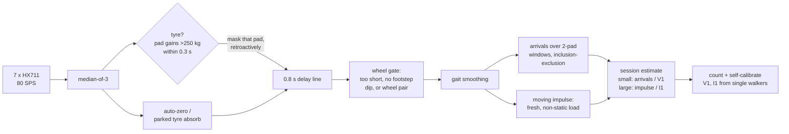

# Zebra Crossing Pedestrian Counter

A strip of load-cell pads lies on the zebra crossing and spans **both lanes**. People move along the lanes just like the vehicles: lane A → and lane B ←. The strip counts everyone who walks over it, reports the total and the count in each direction, and ignores vehicles. An Arduino Mega reads the 14 pads at 80 Hz.

This repository contains:

- the **firmware**, with a counting engine per lane;
- a **calibration sketch** for all 14 pads;
- a **simulator with a local web app** that runs the real Arduino sketches unmodified against a physics model of the road, shows a live "people crossed" counter, and benchmarks accuracy.

> **Result in simulation:** 94–99.7% accurate in total in every scenario, from 4 people/min to 140/min crowds. Per direction it is 93–98.8%. Traffic produced 43 false counts from 728 vehicles, mostly bicycles and motorbikes. See [Accuracy](#accuracy) and [Limitations](#limitations).

---

## Quick start: run the simulator

Needs macOS or Linux with `clang++`/`g++`, `make` and Python 3. There are no other dependencies.

```bash
cd simulation
python3 server.py            # builds the simulator, then serves the app
# open http://localhost:8080
```

In the web app you can:

- watch people and vehicles move along both lanes over the strip;
- see the **PEOPLE CROSSED** counter: a sign at the crossing and a panel on the right, with the total and the → / ← split;
- compare the firmware's count with the ground truth and its live accuracy;
- pick a scenario, change the traffic rates and simulation speed, or spawn people, groups and vehicles by hand (in a chosen lane or a random one);
- use the **Serial Monitor** exactly as on the real board, or switch to the **calibration sketch**;
- run the **accuracy benchmark** on every CPU core.

Benchmark from the command line:

```bash
cd simulation
python3 bench.py                                   # 9 scenarios x 3 seeds x 10 min
python3 bench.py --seeds 5 --seed-start 100        # check on unseen random seeds
```

---

## Layout

```
         x (along the road) ->
   ────────────────────────────────────────────────  kerb
   lane B   <-  <-  people & vehicles   ┃P0 ┃
                                        ┃.. ┃  pads 0-6  : lane B
   - - - - - - - - - - - - - - - - - - -┃P6 ┃- - - - -  centre line
                                        ┃P7 ┃
   lane A   ->  ->  people & vehicles   ┃.. ┃  pads 7-13 : lane A
                                        ┃P13┃
   ────────────────────────────────────────────────  kerb
                                   zebra crossing (4 m), strip 1 m deep in its middle
```

- **14 pads**, each 0.5 m across the road and 1.0 m along it, covering the full 7 m road width.
- Everyone travelling along the road steps across the strip's 1 m depth, so every pedestrian presses at least one pad. Every vehicle's wheels roll over it too, so they have to be rejected.
- **Pads 0–6 belong to lane B (←) and pads 7–13 to lane A (→).** The firmware runs one counting engine per lane, so the direction comes for free.

## Repository layout

```
firmware/
  ZebraCrossingPedestrianCounter/     <- upload this to the Mega
    ZebraCrossingPedestrianCounter.ino    14 pads, two lane engines, Serial, telemetry
    PedestrianCounter.h                   counting engine (no I/O, no malloc)
  HX711_Calibration/
    HX711_Calibration.ino             <- per-pad calibration, all 14 pads
legacy/                               original v1 sketches and README, unchanged
simulation/
  server.py         local web app (Python standard library)
  bench.py          headless accuracy benchmark
  results.json      last benchmark run (shown in the web app)
  src/world.*       physics: gait forces, vehicles, crowds
  src/harness.cpp   runs setup()/loop(), emulates 14 HX711 chips, reads Serial
  arduino/          Arduino core + HX711 library emulation
  web/              the browser UI
```

---

## How the counting works (`PedestrianCounter.h`, per 12.5 ms frame, per lane)



- **Cars, buses and trucks.** A tyre adds more than 250 kg to a pad, or to a pair of pads, within 0.3 s. A crowd can't load a 0.5 m pad that fast. The detector runs on raw samples and masks only the pads under the tyre, retroactively through a 0.8 s delay line, so the tyre's ramp-up never reaches the counter. A tyre parked on the strip is absorbed into its pad's zero after 3 s, so people stepping next to it are counted again.
- **Motorbikes, bicycles and auto-rickshaws.** These are too light for the tyre detector. Instead, the *wheel gate* erases a pad pulse if any of these is true:
  - it is shorter than a human stance (0.33 s);
  - it lacks the **mid-stance dip** of a footstep. A foot's load has a double hump with a dip to about 70% of the peak; a wheel's load is flat on the pad;
  - it forms a front-wheel + rear-wheel pair one wheelbase apart.
- **People.** Two measures are combined:
  - **Arrivals**: the rising part of the load over overlapping 2-pad windows, minus the shared pads, so a person is counted once even when their feet straddle a pad border. This is exact for individuals and small groups.
  - **Moving impulse**: load × time on pads that saw a new footstep, minus any load standing still. It can't cancel, so it holds up in crowds.

  Small sessions use arrivals and big ones impulse, blended in between. Small sessions are rounded; big crowd flows keep fractional counts.
- **Self-calibration.** The per-person constants V1 and I1 are learned from people who clearly crossed alone, so the counter adapts to the local population and walking speed.

---

## Accuracy

Simulated with no hardware. Each scenario was run for 3 random seeds × 10 simulated minutes. Accuracy is `1 − |counted − true| / true`. The firmware is a black box: its count comes only from what it prints on Serial.

| Scenario | Total | → Lane A | ← Lane B |
|---|---|---|---|
| Sparse: 4 people/min, alone | **99.2%** | 98.1% | 97.0% |
| Normal: 14/min, 25% groups, some vehicles | **94.6%** | 96.0% | 93.4% |
| Rush: 36/min, groups, vehicles | **99.7%** | 98.8% | 98.0% |
| Dense: 75/min continuous flow | **99.6%** | 98.6% | 97.7% |
| Festival crowd: 140/min, 50% groups | **96.2%** | 96.2% | 96.1% |
| Signal platoons: ~45 people every 60 s + traffic | **95.5%** | 94.3% | 96.7% |
| 30% of people stop on the strip for 3–25 s | **98.7%** | 93.3% | 95.7% |
| Mixed: 18 people + 10 vehicles/min, 20% stop on strip | **94.7%** | 94.5% | 94.9% |
| Vehicles only, all types: false counts | **43 / 728 vehicles** | | |

False counts by vehicle type (traffic of one type only, 3 × 5 min):

| Car | SUV | Bus | Truck | Auto-rickshaw | Motorbike | Bicycle |
|---|---|---|---|---|---|---|
| 13 / 365 | 10 / 365 | 8 / 352 | 7 / 352 | 27 / 365 | 32 / 362 | 75 / 362 |

All of the car false counts come from cars that stop on the strip and drive off. With no stops, cars produced 0 false counts.

**Unseen seeds.** The parameters were tuned on seeds 1–3. On five unseen seeds (100–104) the total scored 94.4–99.1% per scenario and each direction 93.4–100%. Traffic produced 64 false counts from 1,202 vehicles. The worst single 10-minute run was 89.6%.

---

## Hardware

| Component | Qty | Notes |
|---|---|---|
| Arduino Mega 2560 | 1 | about 4 KB of 8 KB RAM used (two 7-pad engines plus I/O) |
| HX711 load-cell amplifier | 14 | **RATE pin tied to VCC (80 SPS)**. Many breakout boards tie it to GND (10 SPS): move the jumper or cut the trace |
| 1000 kg shear-beam load cell, 2 mV/V | 56 | 4 per pad, wired as one bridge (4000 kg per pad; mechanical stop at 150%) |
| Steel top plate, 0.5 m × 1.0 m, ≥ 10 mm | 14 | aluminium deforms under truck tyres |
| Anti-slip rubber mat | 1 | covers the strip, flush with the road |
| IP65 enclosure, 5 V 3 A supply | 1 | |

**Wiring:** pad *n* (0–13) has DOUT on pin `22 + 2n` and SCK on pin `23 + 2n`, using pins 22–49. All HX711s share 5 V and GND. Pad 0 is at the lane-B kerb and pad 13 at the lane-A kerb.

> [!WARNING]
> The strip must be flush with the road surface. Any lip will damage the cells and trip pedestrians.

## Calibration

1. Upload `firmware/HX711_Calibration/HX711_Calibration.ino` and open the Serial Monitor at 115200 baud, with the line ending set to *Newline*.
2. With the pad empty, send `t`. Put a known weight of at least 20 kg on it and send `k20` (use the actual mass).
3. Send `n` for the next pad and repeat for all 14.
4. Send `a`, then paste the printed `CALIBRATION_FACTORS` array into `ZebraCrossingPedestrianCounter.ino`.

You can try this whole procedure in the simulator: choose *Calibration sketch* and use the *Calibration bench* panel.

## Serial interface (115200 baud)

| Key | Action |
|---|---|
| `r` | reset the counts |
| `t` | tare all pads (keep the strip clear) |
| `s` | status: people crossed, per lane, vehicle events, learned constants, worst frame time |
| `c` | calibration factors, offsets, auto-zero |
| `d` | human-readable pad debug line on/off |
| `m` | telemetry on/off |
| `h` | help |

Each crossing event also prints a human-readable line:

```
Lane A (->): +2 (est 1.87)   PEOPLE CROSSED: 154  [-> 83 | <- 71]
```

Machine-readable lines for a data logger:

```
@T,<ms>,<total>,<live>,<vehicle active>,<vehicle pad mask>,<lane A>,<lane B>,<pad0 kg>,...,<pad13 kg>   every 250 ms
@E,<ms>,<A|B>,<people this event>,<estimate>,<total>                                                  each crossing event
```

---

## How the simulation works

- **Real firmware.** `setup()` and `loop()` from the `.ino` files are compiled natively, unmodified, against an emulated Arduino core: a virtual clock, and Serial with real 115200-baud blocking. They also link against an emulated HX711 library with the same API as *bogde/HX711*.
- **HX711 chips.** There are 14 of them, each with its own unsynchronised 80 SPS conversion clock, averaging over the conversion window. The model includes 24-bit saturation, bridge offset, ±2% per-pad cell tolerance, mechanical noise, temperature drift, rare bit errors, and the 150% overload stop.
- **Pedestrians.** Every footstep produces the standard double-hump ground reaction force. Pressure is spread over the sole, so a foot on the plate edge shares its load with the road. The model covers adults, teens, children, elderly people and runners; groups walking side by side; people stopping on the strip; and crowds slowing down with density (Weidmann's fundamental diagram). People step around a vehicle standing on the crossing.
- **Vehicles.** The model has cars, SUVs, auto-rickshaws, motorbikes, bicycles, buses and trucks in both lanes. Each axle's load sits on tyre contact patches, with suspension bounce while rolling and idle vibration when stopped. Some vehicles stop with their wheels on the strip.
- **Ground truth.** A person counts as crossed when their last foot leaves the strip, and is attributed to their lane.

---

## Limitations

- **These are simulated numbers.** Before relying on the counts, validate on site against a manual count. Self-calibration from single walkers absorbs most of the differences in local population and walking speed.
- **Bicycles and slow two-wheelers.** Light two-wheelers are the weakest case: about 1 false count per 5 bicycles and 1 per 11 motorbikes. Below about 10 km/h their wheels look like slow footsteps. Separating them reliably would need a second row of pads (to measure speed) or another sensor.
- **Stopped vehicles.** A car that stops on the strip and drives off adds about 0.4 false counts on average.
- **Runners.** A running footstep lasts about 0.25 s, so the wheel gate removes most runners. In the simulated population that is about 2% of people.
- **Not yet compiled for the AVR.** No AVR toolchain was available while this was written. The firmware compiles cleanly in strict C++11, which is what avr-gcc uses, and it avoids `String`, heap allocation and 16-bit `int` overflow.
  - Compile it once in the Arduino IDE before deploying.
  - Send `s` to check the **worst frame time**. Two engines × 7 pads of float maths, plus 14 ADC reads, must fit in 12.5 ms on a 16 MHz AVR. The simulator only charges for the ADC reads, so the 840 µs it reports is not representative.
  - If the budget is tight, a Teensy 4.x or an ESP32 runs the same code with a large margin.
