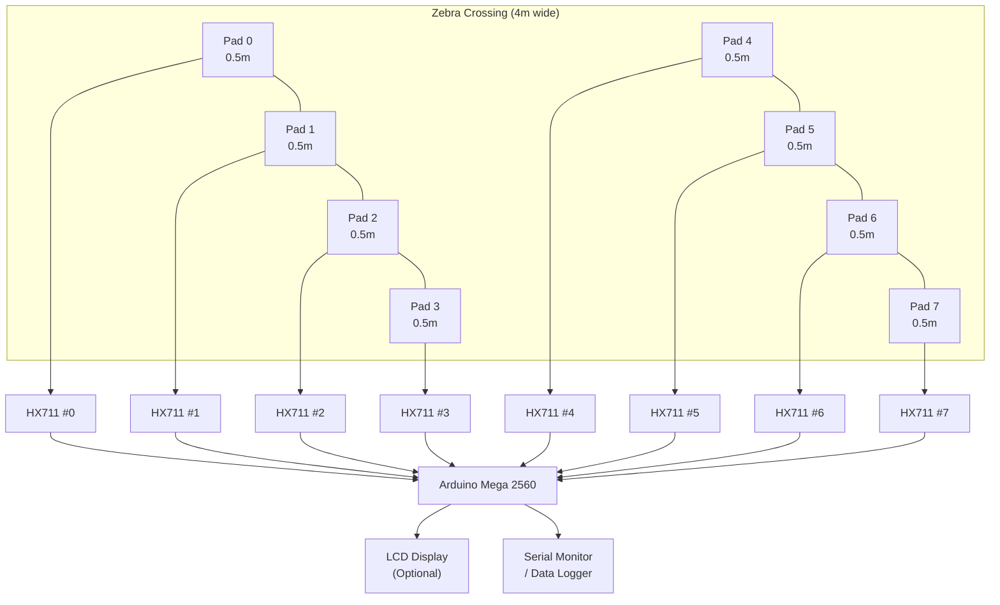
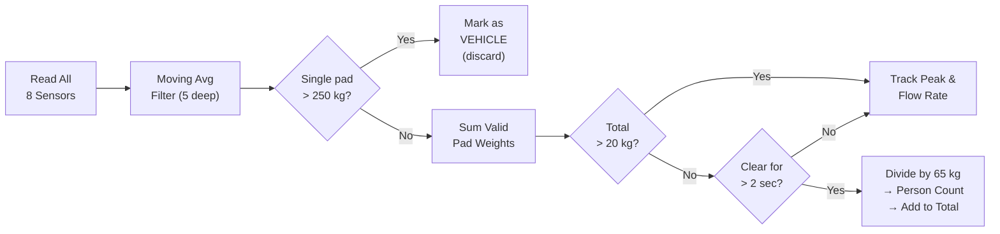

# Zebra Crossing Pedestrian Counter — System Documentation

## Overview

A pressure-sensor-based system that counts pedestrians crossing a zebra crossing in real time, while rejecting vehicle weight (cars, trucks).

---

## Architecture



---

## Detection Logic



---

## Hardware Bill of Materials

| Component | Qty | Purpose |
|---|---|---|
| Arduino Mega 2560 | 1 | Main controller (many I/O pins) |
| HX711 Load Cell Amplifier | 8 | One per sensor pad |
| 50 kg Load Cell (bar type) | 32 | 4 per pad (Wheatstone bridge) |
| Aluminium plate (0.5m × 1m) | 8 | Sensor pad surface |
| Rubber mat (weather protection) | 1 | Covers the entire sensor strip |
| Weatherproof enclosure (IP65) | 1 | Houses Arduino + HX711 boards |
| Power supply (5V, 2A) | 1 | Powers Arduino + sensors |
| I2C LCD 16×2 (optional) | 1 | Live display |

---

## Wiring Table

| Sensor | HX711 DOUT → Arduino Pin | HX711 SCK → Arduino Pin |
|---|---|---|
| Pad 0 | 22 | 23 |
| Pad 1 | 24 | 25 |
| Pad 2 | 26 | 27 |
| Pad 3 | 28 | 29 |
| Pad 4 | 30 | 31 |
| Pad 5 | 32 | 33 |
| Pad 6 | 34 | 35 |
| Pad 7 | 36 | 37 |

All HX711 modules share **VCC → 5V** and **GND → GND** from the Arduino.

---

## Vehicle vs Pedestrian — Thresholds Explained

| Scenario | Weight on ONE 0.5m pad | Verdict |
|---|---|---|
| Empty | 0 kg | Ignore |
| 1 person standing | 30–90 kg | ✅ Pedestrian |
| 2 people sharing pad | 60–180 kg | ✅ Pedestrian |
| Dense crowd (3 ppl on pad) | ~195 kg | ✅ Pedestrian |
| Car tyre (1500 kg / 4) | ~375 kg | ❌ Vehicle — REJECT |
| Truck tyre | 500–2000 kg | ❌ Vehicle — REJECT |
| Motorcycle | ~80 kg on 1–2 pads | ⚠️ Borderline (passes as pedestrian) |

> [!NOTE]
> Motorcycles may be counted as ~1 pedestrian. This is an acceptable trade-off since the alternative (lowering threshold) would reject dense crowds.

---

## Counting Modes

### 1. Single Batch Mode
For light traffic — a group steps on, crosses, steps off.
- Detect occupation → track peak weight → crossing clears → `people = peak_weight / 65`

### 2. Dense Crowd / Continuous Flow Mode
For heavy traffic — people continuously stream across.
- If weight is **stable (±20%)** for **>5 seconds**, assumes continuous flow
- Estimates throughput: `people_per_tick = (weight / 65) × (interval / crossing_time)`
- Average crossing time assumed: **4 seconds**

---

## Calibration Steps

> [!IMPORTANT]
> You **must** calibrate before deployment! Each load cell has a different response.

1. Upload `HX711_Calibration.ino` to Arduino
2. Open Serial Monitor at **115200 baud**
3. Place a known weight (e.g., a 10 kg dumbbell) on the sensor pad
4. Use `+`/`-` keys to adjust until reading matches the known weight
5. Note the calibration factor
6. Update `CALIBRATION_FACTOR` in the main sketch
7. Repeat for each pad (or use the same factor if load cells are identical)

---

## Serial Commands (Runtime)

| Key | Action |
|---|---|
| `r` | Reset pedestrian count to zero |
| `t` | Tare (re-zero) all sensors |
| `s` | Print status summary |
| `c` | Print calibration info |

---

## Tunable Parameters

| Parameter | Default | Description |
|---|---|---|
| `NUM_SENSORS` | 8 | Number of sensor pads |
| `AVG_PERSON_WEIGHT_KG` | 65.0 | Used to estimate count |
| `VEHICLE_THRESHOLD_KG` | 250.0 | Per-pad vehicle rejection |
| `MIN_DETECTION_KG` | 20.0 | Minimum to consider "occupied" |
| `CLEAR_DEBOUNCE_MS` | 2000 | How long clear before finalizing |
| `SAMPLE_INTERVAL_MS` | 100 | Sensor poll rate |
| `INTEGRATION_INTERVAL_MS` | 1000 | Dense crowd tick rate |
| `FILTER_DEPTH` | 5 | Moving average window |
| `AVG_CROSSING_TIME_S` | 4.0 | Estimated pedestrian crossing time |
| `NOISE_FLOOR_KG` | 2.0 | Below this = sensor noise |

---

## Installation Tips

> [!WARNING]
> The sensor strip must be flush with the road surface. Any lip or bump will damage sensors and trip pedestrians.

1. **Trench** a shallow channel across the zebra crossing
2. Place load cells under aluminium plates in the channel
3. Cover with a durable rubber mat (anti-slip, weatherproof)
4. Route cables to a roadside enclosure
5. Seal all connections against water ingress
6. Power via mains adapter or solar + battery for remote locations

---

## Sample Serial Output

```
[ P32 | P67 | P54 |  __ |  __ | P71 | P45 |  __ ] Total: 269.0kg | ~4.1 ppl | Veh:0 | RunTotal: 142

>>> CROSSING OCCUPIED — Pedestrians detected
  [FLOW] ~4.1 people on crossing, throughput this tick: 1.03

─────────────────────────────────────────────
  CROSSING EVENT COMPLETE
  [MODE: Dense crowd / continuous flow]
  Peak weight on crossing: 312.5 kg
  Estimated people this event: 12
  ★ TOTAL PEDESTRIANS COUNTED: 154
─────────────────────────────────────────────
```
